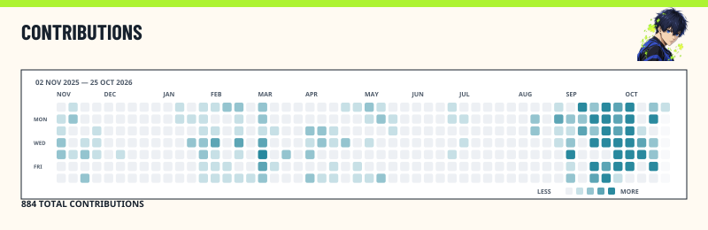

# Contributions tự cập nhật hằng ngày cho bachkhmt

Lịch đã cấu hình: **07:17 sáng mỗi ngày, giờ Việt Nam** (00:17 UTC). GitHub Actions lấy dữ liệu Contributions của `bachkhmt`, tạo lại SVG và commit ảnh vào repository. Sau khi cài một lần, bạn không cần mở Studio, tải lại ảnh hoặc bật máy tính để lịch chạy.

Workflow cập nhật cả bốn thiết kế Contributions và các thẻ khác. `README.md` bạn tự chỉnh được giữ trong các lần chạy theo lịch; ảnh đã nhúng thay đổi vì các file SVG được cập nhật. `PROFILE-README.md` là bản README được generator tạo riêng.

## 1. Chuẩn bị repository profile

Đăng nhập tài khoản `bachkhmt`, mở repository `bachkhmt/bachkhmt`. Nếu chưa có, tạo repository tên **bachkhmt**, chọn **Public**, bật **Add README**. Repository profile cần công khai và có `README.md` ở thư mục gốc để hiển thị trên trang cá nhân. [Hướng dẫn GitHub](https://docs.github.com/en/account-and-profile/how-tos/profile-customization/managing-your-profile-readme).

Cần Git và Node.js 22 trở lên trên máy để thực hiện cách cài bằng PowerShell bên dưới. Kiểm tra:

```powershell
git --version
node --version
npm --version
```

## 2. Chép bộ cài vào repository

Tải và giải nén **bachkhmt-daily-sync.zip** đã cung cấp cùng hướng dẫn này. Đây là bộ source cho generator và workflow, có sẵn `profile.config.json` dùng username `bachkhmt`, các ảnh và snippet.

Mở PowerShell tại thư mục bạn muốn lưu bản clone, rồi chạy:

```powershell
git clone https://github.com/bachkhmt/bachkhmt.git
Set-Location .\bachkhmt
git branch --show-current
```

Nếu đã clone repo, mở PowerShell trong bản clone đó rồi chạy `git pull` thay cho hai lệnh đầu. Làm việc trên nhánh mặc định của repo, thường là `main`.

Trong File Explorer, chép **nội dung bên trong ZIP** vào thư mục repo vừa clone. Các file phải nằm trực tiếp ở gốc repo, không nằm trong một thư mục con tên `ego-striker` hoặc tên ZIP. Bộ cài không chứa `README.md`, nên README đang có của bạn được giữ.

Cấu trúc sau khi chép:

```text
bachkhmt/
  .github/workflows/ego-striker-sync.yml
  src/
  scripts/
  assets/ego-striker/
  package.json
  package-lock.json
  tsconfig.json
  profile.config.json
  PROFILE-README.md
  embed-snippets.md
  variant-snippets.md
  README.md                    ← README profile đang có
```

Kiểm tra `.github/workflows/ego-striker-sync.yml` đã được chép; đây là thư mục ẩn nên dễ bị bỏ sót khi chọn file.

## 3. Đặt banner Contributions vào README

Dán đoạn này vào vị trí bạn muốn trong `README.md`. Nó dùng **Chapter Log / Isagi**, có đủ khổ rộng/nhỏ và màu sáng/tối:

```html
<picture>
  <source media="(max-width: 480px) and (prefers-color-scheme: dark)" srcset="assets/ego-striker/season.chapter-log.isagi.dark.compact.svg">
  <source media="(max-width: 480px)" srcset="assets/ego-striker/season.chapter-log.isagi.light.compact.svg">
  <source media="(prefers-color-scheme: dark)" srcset="assets/ego-striker/season.chapter-log.isagi.dark.wide.svg">
  
</picture>
```

Nếu đã nhúng banner đúng đường dẫn này, không cần dán thêm. Nếu thích thiết kế khác, lấy đoạn tương ứng trong `variant-snippets.md`; workflow cập nhật tất cả thiết kế của nhân vật trong cấu hình. Dùng đường dẫn file SVG trên nhánh, không dùng liên kết chứa SHA của một commit cũ.

Trong `profile.config.json`, tài khoản nằm ở `config.socials.github`, hiện đã là `bachkhmt`. Đây là cấu hình workflow đọc mỗi ngày. Khi sửa thiết kế trong Studio, hãy **Export JSON**, thay `profile.config.json` trong repo bằng file đó và commit để lịch dùng các chỉnh sửa mới.

## 4. Cài dependencies, tạo ảnh và đẩy lên GitHub

Chạy trong thư mục clone:

```powershell
npm ci
npm run generate -- --all-templates
```

Lần chạy local không có token sẽ dùng calendar đã lưu trong cấu hình. Khi chạy trên Actions, workflow truyền `GITHUB_TOKEN` để lấy dữ liệu mới.

Sau đó commit đúng những file dùng cho generator:

```powershell
git add .github/workflows/ego-striker-sync.yml src scripts assets/ego-striker package.json package-lock.json tsconfig.json profile.config.json PROFILE-README.md README.md
git add embed-snippets.md variant-snippets.md FONT-LICENSES.txt ARTWORK-NOTES.txt DAILY-SYNC-SETUP.md
git diff --cached --stat
git commit -m "Set up daily contributions banner"
git push
```

Các lệnh `git add` trên không đưa `node_modules` lên GitHub. Nếu Git yêu cầu đăng nhập khi push, hoàn tất đăng nhập bằng cơ chế Git đang dùng trên máy.

## 5. Bật Actions và chạy thử ngay

Trong repo trên GitHub, vào **Settings → Actions → General** và đảm bảo Actions được phép chạy. Workflow dùng `actions/checkout` và `actions/setup-node`; nếu giới hạn action, cần cho phép hai action này.

Workflow đã khai báo `permissions: contents: write` để bot commit ảnh vào repo. **Không cần tạo Personal Access Token hay tự thêm secret tên GITHUB_TOKEN**; GitHub cung cấp token cho mỗi lần chạy. [Tài liệu quyền Actions](https://docs.github.com/en/repositories/managing-your-repositorys-settings-and-features/enabling-features-for-your-repository/managing-github-actions-settings-for-a-repository), [tài liệu token](https://docs.github.com/en/actions/concepts/security/github_token).

Mở **Actions → Sync Ego Striker Cards → Run workflow**. Chọn nhánh mặc định (`main` nếu repo đang dùng main); để **readme_output = profile**, rồi bấm nút Run workflow. Giá trị `root` sẽ tạo lại toàn bộ `README.md`, nên dùng `profile` khi muốn giữ README đã tự chỉnh.

Khi chạy xong, kiểm tra log bước generate có dòng:

```text
Synced contribution calendar and GitHub stats.
Generated ... SVG cards ...
```

Kiểm tra `profile.config.json` trên GitHub: `config.seasonSource` là `github`, `config.seasonSync.username` là `bachkhmt`, `config.seasonSync.method` là `github-graphql` và `config.seasonSync.at` có thời gian lần chạy mới. Trong lịch sử repo sẽ có commit của `github-actions[bot]` với thông điệp `chore: sync ego-striker profile cards [skip ci]` khi có file thay đổi.

Workflow xanh nhưng log có `GitHub contributions sync skipped` nghĩa là ảnh đã được tạo từ dữ liệu cũ; cần xem thông báo API ở ngay sau dòng đó. Chỉ dấu xanh không đủ để xác nhận dữ liệu đã tải mới.

## 6. Các lần cập nhật tiếp theo

Workflow chạy lúc **07:17 sáng mỗi ngày**. Lịch trong file là:

```yaml
on:
  schedule:
    - cron: '17 0 * * *'
  workflow_dispatch:
```

GitHub chạy lịch trên nhánh mặc định; có thể chạy trễ khi hệ thống bận. Repository công khai không hoạt động trong 60 ngày có thể bị tắt lịch tự động; vào Actions để bật lại khi gặp trường hợp đó. [Quy định về schedule của GitHub](https://docs.github.com/en/actions/reference/workflows-and-actions/events-that-trigger-workflows#schedule).

Muốn cập nhật ngay thì dùng **Run workflow**, không cần tải lại SVG. Sau commit mới, nếu trang profile còn hiện ảnh cũ, hãy kiểm tra SVG trực tiếp trong repo trước và đợi cache ảnh GitHub làm mới.

## Xử lý lỗi thường gặp

| Hiện tượng | Cách kiểm tra |
| --- | --- |
| Không thấy workflow hoặc nút Run workflow | File phải ở `.github/workflows/ego-striker-sync.yml` trên nhánh mặc định; kiểm tra Actions có được bật không. |
| npm không tìm thấy package.json | Đã chép source vào thư mục con; chuyển source về gốc repo. |
| npm ci báo lockfile không khớp | Chép cả `package.json` và `package-lock.json` từ cùng một bộ cài. |
| API báo user not found | Kiểm tra `config.socials.github` là `bachkhmt`, không có `@` hoặc URL GitHub. |
| Bot push bị 403 | Kiểm tra `permissions: contents: write`, chính sách Actions và ruleset/branch protection có chặn bot ghi lên nhánh không. |
| Lịch chạy nhưng banner không đổi | Xem log có sync thành công không, thời gian `seasonSync.at`, đường dẫn ảnh README và commit SVG mới. |
| Sửa trong Studio nhưng lịch quay lại nội dung cũ | Export JSON rồi commit `profile.config.json` mới; lưu trên trình duyệt không tự cập nhật file trên repo. |

Không cần bật GitHub Pages để ảnh trong README được cập nhật. Bộ cài chỉ chứa workflow sync này; việc publish Studio có workflow riêng trong source dự án.
