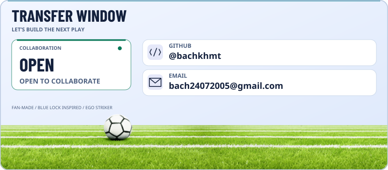

## Hero Banner

<!-- Hero Banner: compact sources must come before wide sources. -->
<picture>
  <source media="(max-width: 480px) and (prefers-color-scheme: dark)" srcset="assets/ego-striker/hero.isagi.dark.compact.svg">
  <source media="(max-width: 480px)" srcset="assets/ego-striker/hero.isagi.light.compact.svg">
  <source media="(prefers-color-scheme: dark)" srcset="assets/ego-striker/hero.isagi.dark.wide.svg">
  
</picture>

## Player Card

<!-- Player Card: compact sources must come before wide sources. -->
<picture>
  <source media="(max-width: 480px) and (prefers-color-scheme: dark)" srcset="assets/ego-striker/player-card.isagi.dark.compact.svg">
  <source media="(max-width: 480px)" srcset="assets/ego-striker/player-card.isagi.light.compact.svg">
  <source media="(prefers-color-scheme: dark)" srcset="assets/ego-striker/player-card.isagi.dark.wide.svg">
  
</picture>

## Tactical Tech Pitch

<!-- Tactical Tech Pitch: compact sources must come before wide sources. -->
<picture>
  <source media="(max-width: 480px) and (prefers-color-scheme: dark)" srcset="assets/ego-striker/tech-pitch.isagi.dark.compact.svg">
  <source media="(max-width: 480px)" srcset="assets/ego-striker/tech-pitch.isagi.light.compact.svg">
  <source media="(prefers-color-scheme: dark)" srcset="assets/ego-striker/tech-pitch.isagi.dark.wide.svg">
  
</picture>

## Match Scoreboard

<!-- Match Scoreboard: compact sources must come before wide sources. -->
<picture>
  <source media="(max-width: 480px) and (prefers-color-scheme: dark)" srcset="assets/ego-striker/match-stats.isagi.dark.compact.svg">
  <source media="(max-width: 480px)" srcset="assets/ego-striker/match-stats.isagi.light.compact.svg">
  <source media="(prefers-color-scheme: dark)" srcset="assets/ego-striker/match-stats.isagi.dark.wide.svg">
  
</picture>

## Language League

<!-- Language League: compact sources must come before wide sources. -->
<picture>
  <source media="(max-width: 480px) and (prefers-color-scheme: dark)" srcset="assets/ego-striker/league-table.isagi.dark.compact.svg">
  <source media="(max-width: 480px)" srcset="assets/ego-striker/league-table.isagi.light.compact.svg">
  <source media="(prefers-color-scheme: dark)" srcset="assets/ego-striker/league-table.isagi.dark.wide.svg">
  
</picture>

## Project Squad

<!-- Project Squad: compact sources must come before wide sources. -->
<picture>
  <source media="(max-width: 480px) and (prefers-color-scheme: dark)" srcset="assets/ego-striker/projects.isagi.dark.compact.svg">
  <source media="(max-width: 480px)" srcset="assets/ego-striker/projects.isagi.light.compact.svg">
  <source media="(prefers-color-scheme: dark)" srcset="assets/ego-striker/projects.isagi.dark.wide.svg">
  
</picture>

## Season Heatmap

<!-- Season Heatmap: compact sources must come before wide sources. -->
<picture>
  <source media="(max-width: 480px) and (prefers-color-scheme: dark)" srcset="assets/ego-striker/season.isagi.dark.compact.svg">
  <source media="(max-width: 480px)" srcset="assets/ego-striker/season.isagi.light.compact.svg">
  <source media="(prefers-color-scheme: dark)" srcset="assets/ego-striker/season.isagi.dark.wide.svg">
  
</picture>

## Transfer Window

<!-- Transfer Window: compact sources must come before wide sources. -->
<picture>
  <source media="(max-width: 480px) and (prefers-color-scheme: dark)" srcset="assets/ego-striker/footer.isagi.dark.compact.svg">
  <source media="(max-width: 480px)" srcset="assets/ego-striker/footer.isagi.light.compact.svg">
  <source media="(prefers-color-scheme: dark)" srcset="assets/ego-striker/footer.isagi.dark.wide.svg">
  
</picture>

[GitHub](<https://github.com/bachkhmt>) · [Email](<mailto:bach24072005%40gmail.com>)