## hero / Classic Banner / isagi / Default

<!-- Hero Banner: compact sources must come before wide sources. -->
<picture>
  <source media="(max-width: 480px) and (prefers-color-scheme: dark)" srcset="assets/ego-striker/hero.isagi.dark.compact.svg">
  <source media="(max-width: 480px)" srcset="assets/ego-striker/hero.isagi.light.compact.svg">
  <source media="(prefers-color-scheme: dark)" srcset="assets/ego-striker/hero.isagi.dark.wide.svg">
  
</picture>

## hero / Manga Poster / isagi / Default

<!-- Hero Banner: compact sources must come before wide sources. -->
<picture>
  <source media="(max-width: 480px) and (prefers-color-scheme: dark)" srcset="assets/ego-striker/hero.poster.isagi.dark.compact.svg">
  <source media="(max-width: 480px)" srcset="assets/ego-striker/hero.poster.isagi.light.compact.svg">
  <source media="(prefers-color-scheme: dark)" srcset="assets/ego-striker/hero.poster.isagi.dark.wide.svg">
  
</picture>

## hero / Volume Cover / isagi / Default

<!-- Hero Banner: compact sources must come before wide sources. -->
<picture>
  <source media="(max-width: 480px) and (prefers-color-scheme: dark)" srcset="assets/ego-striker/hero.volume-cover.isagi.dark.compact.svg">
  <source media="(max-width: 480px)" srcset="assets/ego-striker/hero.volume-cover.isagi.light.compact.svg">
  <source media="(prefers-color-scheme: dark)" srcset="assets/ego-striker/hero.volume-cover.isagi.dark.wide.svg">
  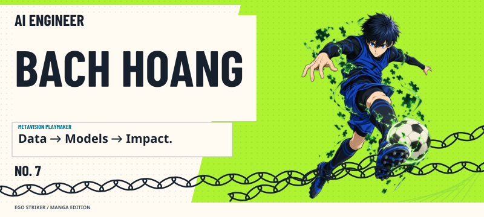
</picture>

## hero / Egoist Poster / isagi / Default

<!-- Hero Banner: compact sources must come before wide sources. -->
<picture>
  <source media="(max-width: 480px) and (prefers-color-scheme: dark)" srcset="assets/ego-striker/hero.egoist-poster.isagi.dark.compact.svg">
  <source media="(max-width: 480px)" srcset="assets/ego-striker/hero.egoist-poster.isagi.light.compact.svg">
  <source media="(prefers-color-scheme: dark)" srcset="assets/ego-striker/hero.egoist-poster.isagi.dark.wide.svg">
  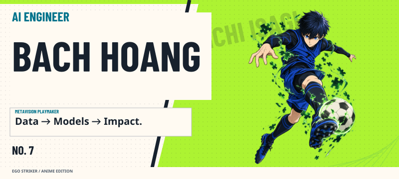
</picture>

## player-card / Attribute Card / isagi / Default

<!-- Player Card: compact sources must come before wide sources. -->
<picture>
  <source media="(max-width: 480px) and (prefers-color-scheme: dark)" srcset="assets/ego-striker/player-card.isagi.dark.compact.svg">
  <source media="(max-width: 480px)" srcset="assets/ego-striker/player-card.isagi.light.compact.svg">
  <source media="(prefers-color-scheme: dark)" srcset="assets/ego-striker/player-card.isagi.dark.wide.svg">
  
</picture>

## player-card / Radar Profile / isagi / Default

<!-- Player Card: compact sources must come before wide sources. -->
<picture>
  <source media="(max-width: 480px) and (prefers-color-scheme: dark)" srcset="assets/ego-striker/player-card.radar.isagi.dark.compact.svg">
  <source media="(max-width: 480px)" srcset="assets/ego-striker/player-card.radar.isagi.light.compact.svg">
  <source media="(prefers-color-scheme: dark)" srcset="assets/ego-striker/player-card.radar.isagi.dark.wide.svg">
  
</picture>

## player-card / Collector Cover / isagi / Default

<!-- Player Card: compact sources must come before wide sources. -->
<picture>
  <source media="(max-width: 480px) and (prefers-color-scheme: dark)" srcset="assets/ego-striker/player-card.collector-cover.isagi.dark.compact.svg">
  <source media="(max-width: 480px)" srcset="assets/ego-striker/player-card.collector-cover.isagi.light.compact.svg">
  <source media="(prefers-color-scheme: dark)" srcset="assets/ego-striker/player-card.collector-cover.isagi.dark.wide.svg">
  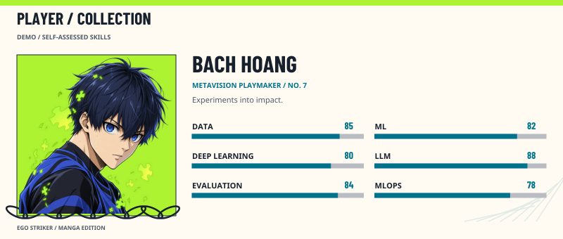
</picture>

## player-card / Egoist Portrait / isagi / Default

<!-- Player Card: compact sources must come before wide sources. -->
<picture>
  <source media="(max-width: 480px) and (prefers-color-scheme: dark)" srcset="assets/ego-striker/player-card.egoist-portrait.isagi.dark.compact.svg">
  <source media="(max-width: 480px)" srcset="assets/ego-striker/player-card.egoist-portrait.isagi.light.compact.svg">
  <source media="(prefers-color-scheme: dark)" srcset="assets/ego-striker/player-card.egoist-portrait.isagi.dark.wide.svg">
  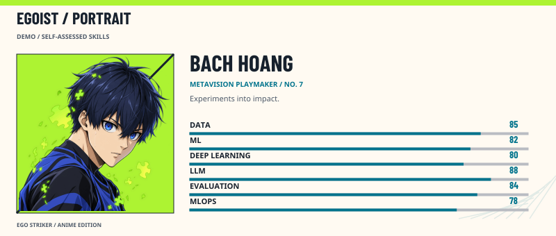
</picture>

## tech-pitch / Tactical Pitch / isagi / Default

<!-- Tactical Tech Pitch: compact sources must come before wide sources. -->
<picture>
  <source media="(max-width: 480px) and (prefers-color-scheme: dark)" srcset="assets/ego-striker/tech-pitch.isagi.dark.compact.svg">
  <source media="(max-width: 480px)" srcset="assets/ego-striker/tech-pitch.isagi.light.compact.svg">
  <source media="(prefers-color-scheme: dark)" srcset="assets/ego-striker/tech-pitch.isagi.dark.wide.svg">
  
</picture>

## tech-pitch / Formation List / isagi / Default

<!-- Tactical Tech Pitch: compact sources must come before wide sources. -->
<picture>
  <source media="(max-width: 480px) and (prefers-color-scheme: dark)" srcset="assets/ego-striker/tech-pitch.formation-list.isagi.dark.compact.svg">
  <source media="(max-width: 480px)" srcset="assets/ego-striker/tech-pitch.formation-list.isagi.light.compact.svg">
  <source media="(prefers-color-scheme: dark)" srcset="assets/ego-striker/tech-pitch.formation-list.isagi.dark.wide.svg">
  
</picture>

## tech-pitch / Chain Tactics / isagi / Default

<!-- Tactical Tech Pitch: compact sources must come before wide sources. -->
<picture>
  <source media="(max-width: 480px) and (prefers-color-scheme: dark)" srcset="assets/ego-striker/tech-pitch.chain-tactics.isagi.dark.compact.svg">
  <source media="(max-width: 480px)" srcset="assets/ego-striker/tech-pitch.chain-tactics.isagi.light.compact.svg">
  <source media="(prefers-color-scheme: dark)" srcset="assets/ego-striker/tech-pitch.chain-tactics.isagi.dark.wide.svg">
  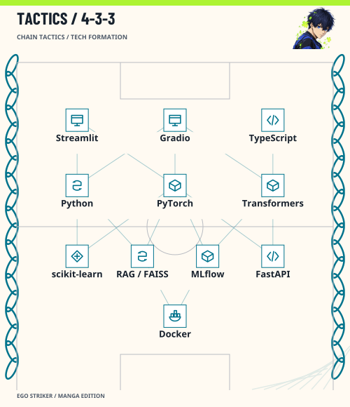
</picture>

## tech-pitch / Puzzle Field / isagi / Default

<!-- Tactical Tech Pitch: compact sources must come before wide sources. -->
<picture>
  <source media="(max-width: 480px) and (prefers-color-scheme: dark)" srcset="assets/ego-striker/tech-pitch.puzzle-field.isagi.dark.compact.svg">
  <source media="(max-width: 480px)" srcset="assets/ego-striker/tech-pitch.puzzle-field.isagi.light.compact.svg">
  <source media="(prefers-color-scheme: dark)" srcset="assets/ego-striker/tech-pitch.puzzle-field.isagi.dark.wide.svg">
  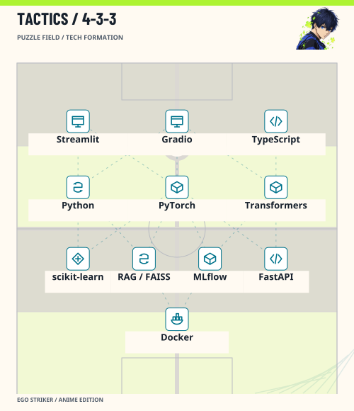
</picture>

## match-stats / Match Scoreboard / isagi / Default

<!-- Match Scoreboard: compact sources must come before wide sources. -->
<picture>
  <source media="(max-width: 480px) and (prefers-color-scheme: dark)" srcset="assets/ego-striker/match-stats.isagi.dark.compact.svg">
  <source media="(max-width: 480px)" srcset="assets/ego-striker/match-stats.isagi.light.compact.svg">
  <source media="(prefers-color-scheme: dark)" srcset="assets/ego-striker/match-stats.isagi.dark.wide.svg">
  
</picture>

## match-stats / Performance Ticker / isagi / Default

<!-- Match Scoreboard: compact sources must come before wide sources. -->
<picture>
  <source media="(max-width: 480px) and (prefers-color-scheme: dark)" srcset="assets/ego-striker/match-stats.ticker.isagi.dark.compact.svg">
  <source media="(max-width: 480px)" srcset="assets/ego-striker/match-stats.ticker.isagi.light.compact.svg">
  <source media="(prefers-color-scheme: dark)" srcset="assets/ego-striker/match-stats.ticker.isagi.dark.wide.svg">
  
</picture>

## match-stats / Issue Score / isagi / Default

<!-- Match Scoreboard: compact sources must come before wide sources. -->
<picture>
  <source media="(max-width: 480px) and (prefers-color-scheme: dark)" srcset="assets/ego-striker/match-stats.issue-score.isagi.dark.compact.svg">
  <source media="(max-width: 480px)" srcset="assets/ego-striker/match-stats.issue-score.isagi.light.compact.svg">
  <source media="(prefers-color-scheme: dark)" srcset="assets/ego-striker/match-stats.issue-score.isagi.dark.wide.svg">
  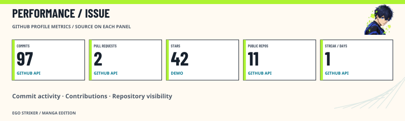
</picture>

## match-stats / Impact Panel / isagi / Default

<!-- Match Scoreboard: compact sources must come before wide sources. -->
<picture>
  <source media="(max-width: 480px) and (prefers-color-scheme: dark)" srcset="assets/ego-striker/match-stats.impact-panel.isagi.dark.compact.svg">
  <source media="(max-width: 480px)" srcset="assets/ego-striker/match-stats.impact-panel.isagi.light.compact.svg">
  <source media="(prefers-color-scheme: dark)" srcset="assets/ego-striker/match-stats.impact-panel.isagi.dark.wide.svg">
  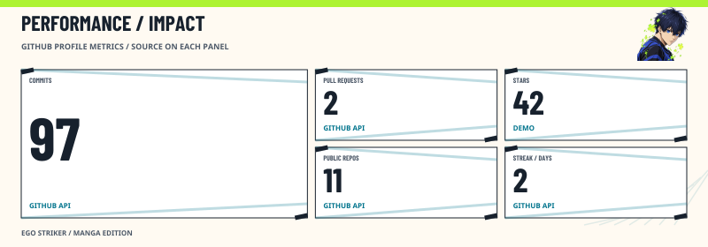
</picture>

## league-table / Language League / isagi / Default

<!-- Language League: compact sources must come before wide sources. -->
<picture>
  <source media="(max-width: 480px) and (prefers-color-scheme: dark)" srcset="assets/ego-striker/league-table.isagi.dark.compact.svg">
  <source media="(max-width: 480px)" srcset="assets/ego-striker/league-table.isagi.light.compact.svg">
  <source media="(prefers-color-scheme: dark)" srcset="assets/ego-striker/league-table.isagi.dark.wide.svg">
  
</picture>

## league-table / Language Podium / isagi / Default

<!-- Language League: compact sources must come before wide sources. -->
<picture>
  <source media="(max-width: 480px) and (prefers-color-scheme: dark)" srcset="assets/ego-striker/league-table.podium.isagi.dark.compact.svg">
  <source media="(max-width: 480px)" srcset="assets/ego-striker/league-table.podium.isagi.light.compact.svg">
  <source media="(prefers-color-scheme: dark)" srcset="assets/ego-striker/league-table.podium.isagi.dark.wide.svg">
  
</picture>

## league-table / Ranking Volume / isagi / Default

<!-- Language League: compact sources must come before wide sources. -->
<picture>
  <source media="(max-width: 480px) and (prefers-color-scheme: dark)" srcset="assets/ego-striker/league-table.ranking-volume.isagi.dark.compact.svg">
  <source media="(max-width: 480px)" srcset="assets/ego-striker/league-table.ranking-volume.isagi.light.compact.svg">
  <source media="(prefers-color-scheme: dark)" srcset="assets/ego-striker/league-table.ranking-volume.isagi.dark.wide.svg">
  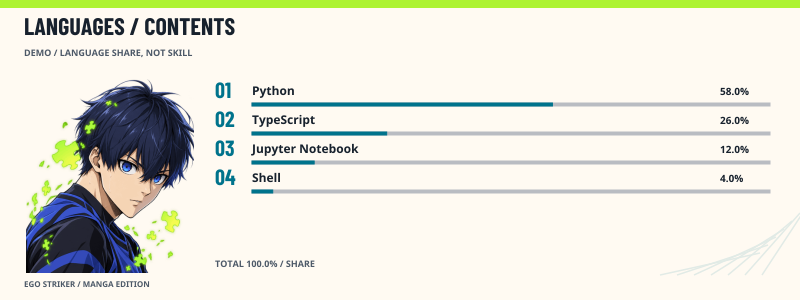
</picture>

## league-table / Egoist Awards / isagi / Default

<!-- Language League: compact sources must come before wide sources. -->
<picture>
  <source media="(max-width: 480px) and (prefers-color-scheme: dark)" srcset="assets/ego-striker/league-table.egoist-awards.isagi.dark.compact.svg">
  <source media="(max-width: 480px)" srcset="assets/ego-striker/league-table.egoist-awards.isagi.light.compact.svg">
  <source media="(prefers-color-scheme: dark)" srcset="assets/ego-striker/league-table.egoist-awards.isagi.dark.wide.svg">
  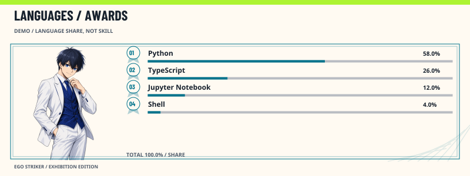
</picture>

## projects / Project Squad / isagi / Default

<!-- Project Squad: compact sources must come before wide sources. -->
<picture>
  <source media="(max-width: 480px) and (prefers-color-scheme: dark)" srcset="assets/ego-striker/projects.isagi.dark.compact.svg">
  <source media="(max-width: 480px)" srcset="assets/ego-striker/projects.isagi.light.compact.svg">
  <source media="(prefers-color-scheme: dark)" srcset="assets/ego-striker/projects.isagi.dark.wide.svg">
  
</picture>

## projects / Compact Project List / isagi / Default

<!-- Project Squad: compact sources must come before wide sources. -->
<picture>
  <source media="(max-width: 480px) and (prefers-color-scheme: dark)" srcset="assets/ego-striker/projects.compact-list.isagi.dark.compact.svg">
  <source media="(max-width: 480px)" srcset="assets/ego-striker/projects.compact-list.isagi.light.compact.svg">
  <source media="(prefers-color-scheme: dark)" srcset="assets/ego-striker/projects.compact-list.isagi.dark.wide.svg">
  
</picture>

## projects / Volume Shelf / isagi / Default

<!-- Project Squad: compact sources must come before wide sources. -->
<picture>
  <source media="(max-width: 480px) and (prefers-color-scheme: dark)" srcset="assets/ego-striker/projects.volume-shelf.isagi.dark.compact.svg">
  <source media="(max-width: 480px)" srcset="assets/ego-striker/projects.volume-shelf.isagi.light.compact.svg">
  <source media="(prefers-color-scheme: dark)" srcset="assets/ego-striker/projects.volume-shelf.isagi.dark.wide.svg">
  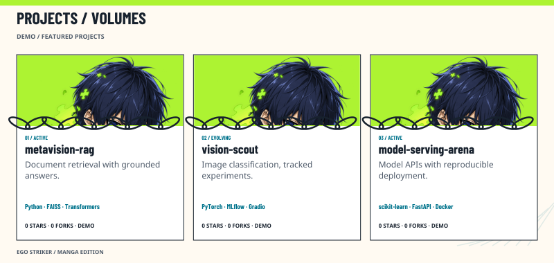
</picture>

## projects / Rival Panels / isagi / Default

<!-- Project Squad: compact sources must come before wide sources. -->
<picture>
  <source media="(max-width: 480px) and (prefers-color-scheme: dark)" srcset="assets/ego-striker/projects.rival-panels.isagi.dark.compact.svg">
  <source media="(max-width: 480px)" srcset="assets/ego-striker/projects.rival-panels.isagi.light.compact.svg">
  <source media="(prefers-color-scheme: dark)" srcset="assets/ego-striker/projects.rival-panels.isagi.dark.wide.svg">
  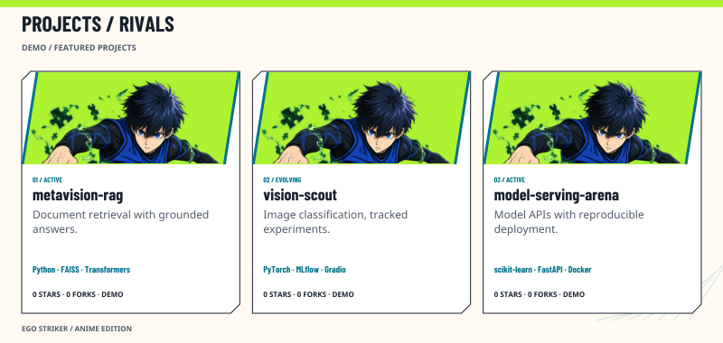
</picture>

## season / Season Heatmap / isagi / Default

<!-- Season Heatmap: compact sources must come before wide sources. -->
<picture>
  <source media="(max-width: 480px) and (prefers-color-scheme: dark)" srcset="assets/ego-striker/season.isagi.dark.compact.svg">
  <source media="(max-width: 480px)" srcset="assets/ego-striker/season.isagi.light.compact.svg">
  <source media="(prefers-color-scheme: dark)" srcset="assets/ego-striker/season.isagi.dark.wide.svg">
  
</picture>

## season / Calendar Grid / isagi / Default

<!-- Season Heatmap: compact sources must come before wide sources. -->
<picture>
  <source media="(max-width: 480px) and (prefers-color-scheme: dark)" srcset="assets/ego-striker/season.calendar-grid.isagi.dark.compact.svg">
  <source media="(max-width: 480px)" srcset="assets/ego-striker/season.calendar-grid.isagi.light.compact.svg">
  <source media="(prefers-color-scheme: dark)" srcset="assets/ego-striker/season.calendar-grid.isagi.dark.wide.svg">
  
</picture>

## season / Chapter Log / isagi / Default

<!-- Season Heatmap: compact sources must come before wide sources. -->
<picture>
  <source media="(max-width: 480px) and (prefers-color-scheme: dark)" srcset="assets/ego-striker/season.chapter-log.isagi.dark.compact.svg">
  <source media="(max-width: 480px)" srcset="assets/ego-striker/season.chapter-log.isagi.light.compact.svg">
  <source media="(prefers-color-scheme: dark)" srcset="assets/ego-striker/season.chapter-log.isagi.dark.wide.svg">
  
</picture>

## season / Training Panels / isagi / Default

<!-- Season Heatmap: compact sources must come before wide sources. -->
<picture>
  <source media="(max-width: 480px) and (prefers-color-scheme: dark)" srcset="assets/ego-striker/season.training-panels.isagi.dark.compact.svg">
  <source media="(max-width: 480px)" srcset="assets/ego-striker/season.training-panels.isagi.light.compact.svg">
  <source media="(prefers-color-scheme: dark)" srcset="assets/ego-striker/season.training-panels.isagi.dark.wide.svg">
  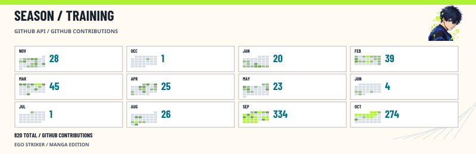
</picture>

## footer / Transfer Window / isagi / Default

<!-- Transfer Window: compact sources must come before wide sources. -->
<picture>
  <source media="(max-width: 480px) and (prefers-color-scheme: dark)" srcset="assets/ego-striker/footer.isagi.dark.compact.svg">
  <source media="(max-width: 480px)" srcset="assets/ego-striker/footer.isagi.light.compact.svg">
  <source media="(prefers-color-scheme: dark)" srcset="assets/ego-striker/footer.isagi.dark.wide.svg">
  
</picture>

[GitHub](<https://github.com/bachkhmt>) · [Email](<mailto:bach24072005%40gmail.com>)

## footer / Full-time Strip / isagi / Default

<!-- Transfer Window: compact sources must come before wide sources. -->
<picture>
  <source media="(max-width: 480px) and (prefers-color-scheme: dark)" srcset="assets/ego-striker/footer.full-time-strip.isagi.dark.compact.svg">
  <source media="(max-width: 480px)" srcset="assets/ego-striker/footer.full-time-strip.isagi.light.compact.svg">
  <source media="(prefers-color-scheme: dark)" srcset="assets/ego-striker/footer.full-time-strip.isagi.dark.wide.svg">
  
</picture>

[GitHub](<https://github.com/bachkhmt>) · [Email](<mailto:bach24072005%40gmail.com>)

## footer / Chain Ticket / isagi / Default

<!-- Transfer Window: compact sources must come before wide sources. -->
<picture>
  <source media="(max-width: 480px) and (prefers-color-scheme: dark)" srcset="assets/ego-striker/footer.chain-ticket.isagi.dark.compact.svg">
  <source media="(max-width: 480px)" srcset="assets/ego-striker/footer.chain-ticket.isagi.light.compact.svg">
  <source media="(prefers-color-scheme: dark)" srcset="assets/ego-striker/footer.chain-ticket.isagi.dark.wide.svg">
  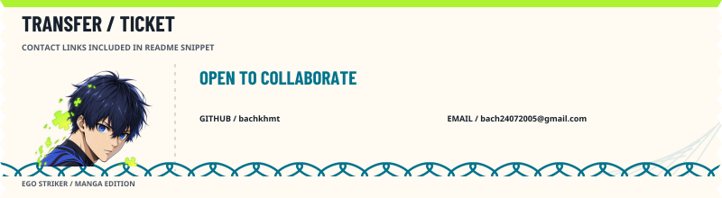
</picture>

[GitHub](<https://github.com/bachkhmt>) · [Email](<mailto:bach24072005%40gmail.com>)

## footer / Exhibition Pass / isagi / Default

<!-- Transfer Window: compact sources must come before wide sources. -->
<picture>
  <source media="(max-width: 480px) and (prefers-color-scheme: dark)" srcset="assets/ego-striker/footer.exhibition-pass.isagi.dark.compact.svg">
  <source media="(max-width: 480px)" srcset="assets/ego-striker/footer.exhibition-pass.isagi.light.compact.svg">
  <source media="(prefers-color-scheme: dark)" srcset="assets/ego-striker/footer.exhibition-pass.isagi.dark.wide.svg">
  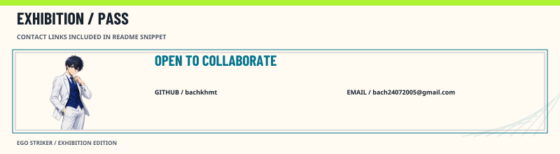
</picture>

[GitHub](<https://github.com/bachkhmt>) · [Email](<mailto:bach24072005%40gmail.com>)